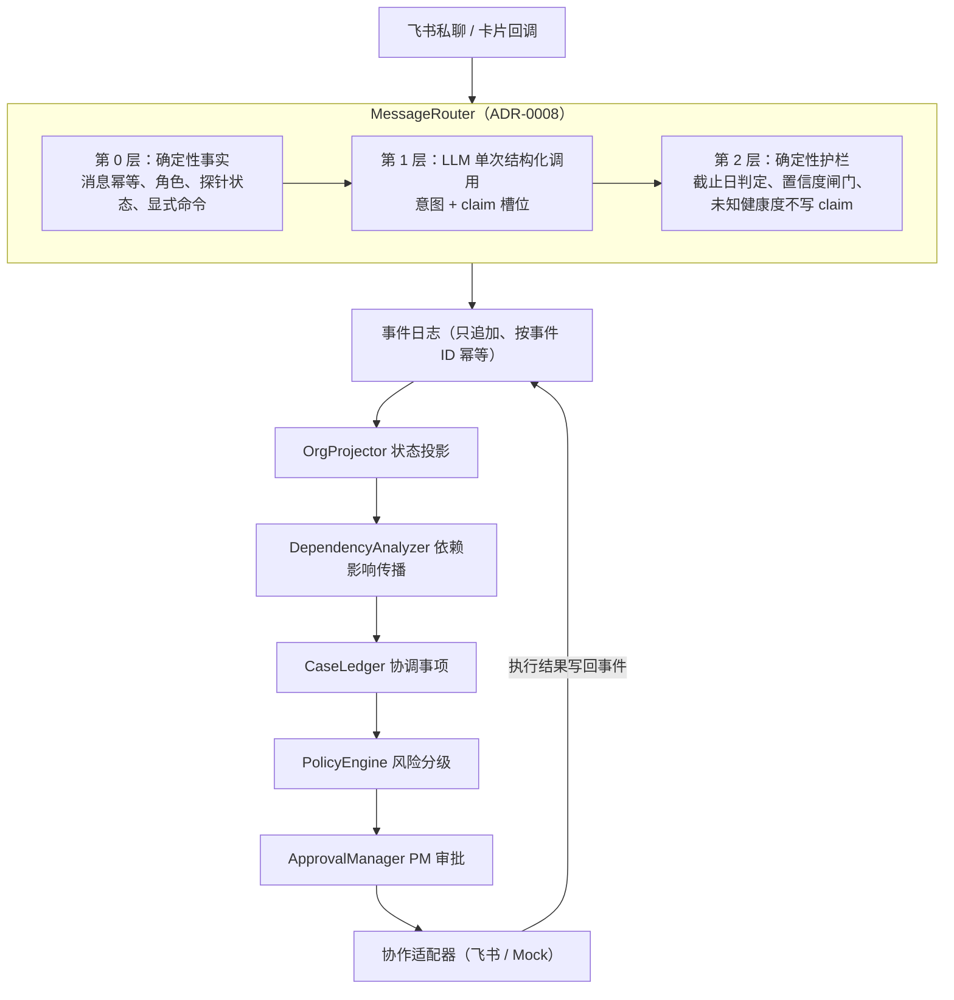

# OrgPilot

面向多人研发团队的有状态协调 Agent。它把飞书私聊消息、任务和成员承诺统一成**可回放的组织状态**，
在有人报告延期时算出影响范围，决定该问谁、是否升级、是否改期；改期这类高影响动作必须经 PM 审批。

> **当前状态**：协调内核和分层意图识别已经过验证（离线回放与评测）；飞书接入代码已完成，
> 但真实团队的完整业务流程还没有跑通。各部分的完成度见[当前状态](#当前状态)，不要只看功能列表。

## 为什么不只是一个飞书机器人

- **状态优先**：所有状态都来自只追加的事件日志，投影是确定的，任意时刻都能重放和核对。
  LLM 只负责把自然语言变成带原文引文的结构化声明（claim），不能直接改官方状态。
- **两种状态分开**：`workflow_status`（任务系统里的官方状态）和 `health_status`（成员自己说的健康度）
  分别维护，"成员说快好了"不会把任务直接标成完成。
- **有副作用的动作不依赖识别准确率**：全员同步只有 `pm` 能发起，用自然语言请求时要先点确认卡片；
  改截止时间要先过策略检查，再由 PM 审批。
- **平台无关**：Mock 适配器下整套流程都能跑，飞书只是其中一个适配器。

## 工作方式



一个典型流程（对应 `evals/scenarios/` 里的回放场景）：

1. 成员私聊"支付 SDK 还在报错，下周三前修好"，意图层产出一条 claim：健康度、预计完成时间、原文引文；
2. 预计完成时间晚于任务截止日，护栏把健康度定为 `delayed`；依赖分析标出受影响的下游任务（`delay_propagation`）；
3. CaseLedger 开一个协调事项，规划候选动作（私聊追问或改期提议）；
4. 改期属于高影响动作，策略引擎要求审批，系统给 PM 发交互式审批卡片；
5. PM 批准后更新截止时间并写入事件；拒绝或成员一直不回复则升级（`m1_02` / `m1_03` / `m1_05`）。

PM 发 `/同步`（或用自然语言请求同步，这时要先点确认卡片）后，系统向各负责人发进度探针；
回答不完整就追问（有总次数上限），最后汇总成简报发给 PM。

## 当前状态

| 部分 | 状态 | 说明 |
|---|---|---|
| 可回放协调内核（事件 → 投影 → 依赖影响 → 协调事项 → 策略） | ✅ 已验证 | 9 个 ground-truth 场景回放通过（4 个 P0 + 5 个 M1） |
| Mock 闭环 Agent（CaseLedger、三阶段动作、审批门禁、有界循环） | ✅ 已验证 | 同上 |
| 分层意图识别（ADR-0008 第 1–3 步） | ✅ 离线评测通过 | DeepSeek V4.1 Flash，提示词已冻结，见[评测](#评测) |
| SQL 持久化 + FastAPI 网关 | 🟡 原型 | 默认 SQLite、单实例；重启后进行中的对话与同步会话可恢复（ADR-0013，有重启测试）；PostgreSQL 没做过环境验证 |
| 飞书接入（Webhook、WebSocket 长连接、交互卡片） | 🟡 代码完成 | 报延期 → 审批卡片 → 批准改期的整条链路有端到端测试（Mock 飞书客户端）；真实租户里只做过单账号冒烟，演示步骤见 [`docs/feishu-demo-runbook.md`](docs/feishu-demo-runbook.md) |
| 团队名单导入 `team.yaml`（ADR-0009） | 🟡 预览已实测 | 真实租户里预览导入通过；正式导入未验证 |
| Web 控制台（DAG、解释时间线、审批台、多角色沙箱聊天） | ✅ 可本地演示 | Mock 模式下不需要任何凭据 |
| 协调层对比 benchmark（对比 Chatbot / 规则提醒 / 只维护状态的 Agent） | ⬜ 未开始 | 设计见 `OrgPilot-Initial-Design.md` §15 |
| GitHub 集成（ADR-0007） | ⬜ 只有提案 | — |

## 评测

### 意图识别（冻结提示词 `c9850dec6655`，DeepSeek V4.1 Flash）

| 指标 | dev（102 条） | test（58 条，留出集） | 多轮对话（10 段 36 轮） |
|---|---|---|---|
| 行为通过率 | 95.1%（97/102） | 91.4%（53/58） | 10/10 |
| 错误 claim 率 | 3.08%（2/65） | 0%（0/39） | — |
| claim 精确率 | 93.2% | 89.5% | — |
| 未经确认的群发 | 0（4 条需确认样本） | 0（3 条需确认样本） | — |
| 同步误触发率 | 0% | 0% | — |
| p95 延迟 / 每条费用 | 1962.7 ms / $0.00035 | — | 1638.0 ms / $0.00037 |

口径（读数字前先看这里）：

- **行为通过率**：一条样本的 claim、同步触发、追问、回复类别全部符合标注才算通过，不是意图分类准确率；
- **错误 claim 率**只统计"不该生成 claim 却生成了"的样本；有 claim 的样本里多出来或写错的 claim 只体现在精确率里；
- test 集已冻结（sha256 记在 `BASELINE.md`，改动要先审批）。`c9850dec6655` 是第一个、也是目前唯一看过 test 结果的提示词版本；
- 样本是按 `LABELING.md` 规则自建的对抗集（疑问、否定、假设、多任务、追问回答、近义反例等），**不是真实用户消息**。
  下一份留出集计划用内测中经同意、脱敏后的真实消息；
- 对照：不用模型的启发式客户端 dev 行为通过率 22.55%；oracle（把标注直接喂给流水线）100%，
  说明流水线本身不丢分，剩下的误差来自模型。

完整历史、逐轮修订和已知分歧见 [`evals/intent/BASELINE.md`](evals/intent/BASELINE.md)。
在线评测的模型响应都已录制入库，可以离线复跑，不发请求、不产生费用：

```powershell
$env:ORGPILOT_LLM_PROVIDER = "deepseek"
$env:DEEPSEEK_API_KEY = "replay"   # 回放模式不发请求，但 CLI 目前仍要求 key 非空
uv run orgpilot eval-intent --split dev --client llm --replay
uv run orgpilot eval-intent --split test --client llm --replay
uv run orgpilot eval-intent --conversations --client llm --replay
```

### 协调内核

`uv run orgpilot replay --all` 回放 `evals/scenarios/` 下的 9 个场景，逐项断言状态、受影响任务、协调事项和终止原因。
`evals/extraction/` 的 20 条 claim 抽取金标是离线确定性回归测试，**不代表线上模型的准确率**。

## 快速开始

需要 Python 3.12+ 和 [uv](https://docs.astral.sh/uv/)。

```powershell
uv sync --dev
uv run orgpilot replay --all
uv run pytest
uv run ruff check .
```

启动网关和 Web 控制台（默认 Mock 适配器、离线客户端，不需要任何凭据）：

```powershell
uv run uvicorn orgpilot.gateway.app:create_app --factory --port 8000
```

打开 `http://localhost:8000/`，可以看 DAG 拓扑、解释时间线、PM 审批台，以及多角色沙箱聊天。

### 接入 LLM（可选）

配置参考 `.env.example`。意图层默认用启发式客户端（`ORGPILOT_INTENT_CLIENT=heuristic`），换成 LLM：

```powershell
$env:ORGPILOT_LLM_PROVIDER = "deepseek"     # 或 aihubmix，两者共用一个 Anthropic 兼容客户端
$env:DEEPSEEK_API_KEY = "<set securely>"
$env:ORGPILOT_INTENT_CLIENT = "llm"
uv run uvicorn orgpilot.gateway.app:create_app --factory --port 8000
```

`ORGPILOT_LLM_THINKING`（`omit` / `disabled` / `enabled`）控制 Anthropic 格式的 thinking 字段：
AIHubMix 默认 `omit`（不发送该字段），DeepSeek 默认 `disabled`（它的服务端默认是开启的）。

### 接入飞书和真实团队

1. 按 [`docs/feishu-setup-guide.md`](docs/feishu-setup-guide.md) 创建自建应用、开通权限；
2. 复制 `team.example.yaml` 为 `team.yaml`（已在 `.gitignore` 中，里面有同事的邮箱和手机号），填写成员和任务；
3. 导入名单：

```powershell
uv run orgpilot team import team.yaml --dry-run
uv run orgpilot team import team.yaml
uv run orgpilot team show
```

演示用的"第一个发消息的人自动成为 PM"只在 `ORGPILOT_DEMO_MODE=true` 时生效，真实团队请用名单导入。
完整的真实演示步骤和检查点见 [`docs/feishu-demo-runbook.md`](docs/feishu-demo-runbook.md)。

PM 批准改期后，更新的是 OrgPilot 里的任务截止时间。名单导入的任务不在飞书任务里，所以默认不调用飞书任务接口；
只有任务 ID 本身就是飞书任务 guid 时，才设置 `ORGPILOT_FEISHU_TASK_WRITEBACK=true` 同步写回。

## 关键设计取舍

- **LLM 的边界**：模型只产出 claim，状态变更全部由确定性代码完成（ADR-0003、ADR-0008）；
- **规则放代码，不放提示词**：截止日比较、未知健康度不写 claim、追问次数上限都是护栏代码，有单元测试；
- **评测纪律**：test 集冻结并有哈希校验，提示词改动只看 dev 和对话评测；在线响应录制回放，测试全部离线；
- **导入不回滚审批**：重新导入名单时，任务字段按"上次导入的值 / 当前名单 / 运行时值"三方比对，
  已批准的改期不会被旧名单悄悄改回去；事件 ID 确定，重放幂等（ADR-0009）。

## 已知限制

- 重启后，待回答的追问、待确认的同步卡片和进行中的同步会话会从数据库恢复（ADR-0013），但发消息和保存状态不在同一个事务里：
  恰好在两者之间崩溃时，探针或简报可能重发一次。LLM 花费预算（`--max-spend-usd`）只在进程内累计，重启后清零；
- 只处理私聊，群聊消息直接拒收；飞书多维表格和日历还没接入；
- claim 合并规则（ADR-0008 第 4 步）没实现；ADR-0008 登记了 7 个待修的意图识别已知问题；
- 单实例部署，PostgreSQL 未验证；
- 协调层 benchmark 还没做，目前没有"依赖图、承诺模型带来多少提升"的量化证据。

## 文档

| 文档 | 内容 |
|---|---|
| [`docs/architecture.md`](docs/architecture.md) | 架构、模块边界与状态流 |
| [`docs/event-semantics.md`](docs/event-semantics.md) | 事件信封、生命周期、幂等与 LLM 边界 |
| [`docs/ground-truth-scenarios.md`](docs/ground-truth-scenarios.md) | P0 / M1 回放场景规格 |
| [`docs/feishu-setup-guide.md`](docs/feishu-setup-guide.md) | 飞书自建应用、权限与名单导入 |
| [`docs/feishu-demo-runbook.md`](docs/feishu-demo-runbook.md) | 真实飞书演示的步骤、检查点与排错 |
| [`docs/development.md`](docs/development.md) | 开发环境、Git 工作流、完成标准 |
| [`docs/development-log.md`](docs/development-log.md) | 每一步已实现、已验证、未覆盖的内容 |
| [`evals/intent/LABELING.md`](evals/intent/LABELING.md) | 意图评测标注规则 |
| [`evals/intent/BASELINE.md`](evals/intent/BASELINE.md) | 意图评测历史数字与口径 |
| [`OrgPilot-Initial-Design.md`](OrgPilot-Initial-Design.md) | 初期设计（目标与里程碑，不代表已实现） |

架构决策记录（ADR）：

- [ADR-0001](docs/adr/0001-replayable-coordination-kernel.md) 可回放协调内核
- [ADR-0002](docs/adr/0002-coordination-case-lifecycle.md) 协调事项生命周期与闭环
- [ADR-0003](docs/adr/0003-llm-claim-extraction-boundary.md) LLM 声明抽取与安全边界
- [ADR-0004](docs/adr/0004-postgresql-event-store-and-fastapi-gateway.md) SQL 持久化与 FastAPI 网关
- [ADR-0005](docs/adr/0005-feishu-adapter-and-interactive-cards.md) 飞书适配器与交互卡片
- [ADR-0006](docs/adr/0006-web-dashboard-and-dag-visualization.md) Web 控制台与 DAG 可视化
- [ADR-0007](docs/adr/0007-github-integration-and-pr-only-permission.md) GitHub 集成与仅 PR 写权限（提案）
- [ADR-0008](docs/adr/0008-layered-intent-recognition.md) 分层意图识别
- [ADR-0009](docs/adr/0009-team-onboarding-and-roster-import.md) 团队接入与名单导入
- [ADR-0013](docs/adr/0013-persist-in-flight-conversations.md) 进行中的对话状态与同步会话持久化（0010–0012 为另一分支上的草稿预留）

## 代码结构

```text
src/orgpilot/
├── events/        # 不可变事件契约与事件日志
├── state/         # 事件 → 组织状态投影
├── dependencies/  # 依赖图校验与影响传播
├── coordination/  # CaseLedger、审批、同步协调器
├── policy/        # 动作风险分级与审批门禁
├── agent/         # 有界 Agent Loop 与执行轨迹
├── intent/        # MessageRouter、意图客户端、护栏、评测
├── extraction/    # claim 抽取、原文反查、相对时间解析
├── team/          # team.yaml 解析与导入计划
├── feishu/        # 飞书 OpenAPI、Webhook、WebSocket、卡片
├── gateway/       # FastAPI 网关与 Web 控制台
├── storage/       # SQLAlchemy 异步持久化
└── scenarios/     # ground-truth 场景加载、回放与断言
```
