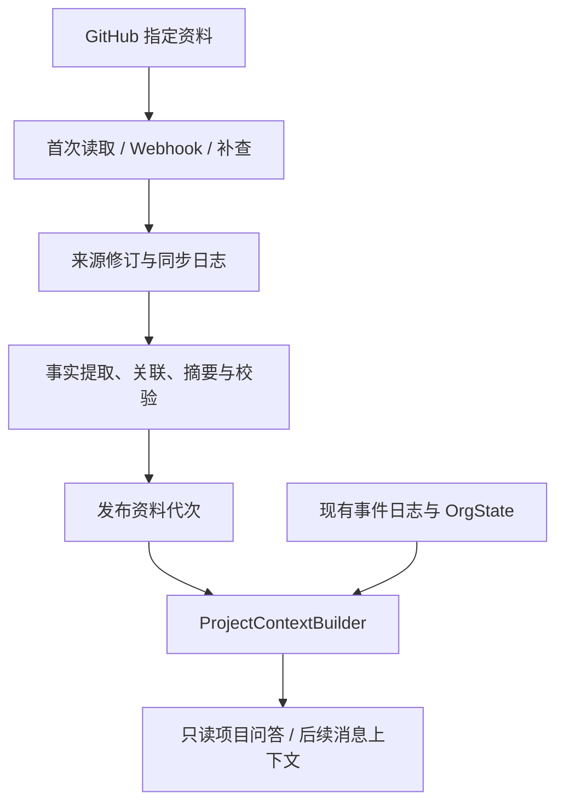

# ADR-0015：从 GitHub 接入并持续同步项目上下文

- 状态：**已按用户指令实施于 PR #20，九项审查修复与离线验证完成；尚未合并，真实接入与在线质量验收待完成**。
- 日期：2026-11-03；范围：M2-0，先于 R1 依赖等待。
- 设计时基线：`main@778bfb3`，当时 524 项测试、覆盖率 92.58%、生命周期 58/59；PR #20 的当前验证以开发日志为准。
- 配套：[分步开发计划](../project-context-development-plan.md)、[M2 消息驱动计划](../m2-message-driven-plan.md)。
- 本文保留设计契约；实现与验证证据见开发日志和 `project-context-review-fixes.md`，不以设计条目代替测试结果。
- 同日补充：首版包含有界的多轮主动查阅；后续开发采用 C1–C6 连续实施、逐阶段验证与提交，最后统一审查。

## 1. 问题与代码依据

Agent 需要能说明项目目标、交付约定、当前工作及其依据；资料不足、冲突或滞后时，能指出缺口。
这项能力依赖可追溯的项目资料、更新机制和本轮上下文，不能仅凭任务标题推断业务。

| 当前实现 | 本设计的衔接约束 |
|---|---|
| [TeamSpec / TaskSpec](../../src/orgpilot/team/spec.py) 导入名单与任务，尚无项目目标、交付说明或资料来源模型 | 新增独立资料绑定；不要求团队重新录入所有文档 |
| [OrgState](../../src/orgpilot/domain/models.py) 保存任务、成员、健康声明和承诺 | 正式运行状态与资料索引分开维护 |
| [OrgEvent](../../src/orgpilot/events/models.py) 是固定的任务 / 成员 / 承诺事件联合 | GitHub 原始通知不能直接塞进现有事件表 |
| [SqlEventStore](../../src/orgpilot/storage/event_store.py) 按事件 ID 和载荷哈希去重，按业务时间重放 | 保留原契约；可变文档的修订使用另一套身份与日志 |
| [GatewayService](../../src/orgpilot/gateway/service.py) 可只恢复 Agent；commit_extracted_events 可推进协调轮次 | 项目问答只读恢复状态，不能调用摄入或协调执行入口 |
| [TaskSnapshot / IntentContext](../../src/orgpilot/intent/client.py) 与 [上下文构建](../../src/orgpilot/intent/router.py) 只提供任务简表、待答事项和近期对话 | 新增资料上下文组装；现有分类器不等同于项目问答生成器 |
| [Database](../../src/orgpilot/storage/database.py) 使用 create_all 和每 session 自动 commit | 新增表可独立初始化；跨表原子发布须共享 session，create_all 不能迁移已有列 |
| [ADR-0007](0007-github-integration-and-pr-only-permission.md) 仍是未实现草案 | 可参考其 App / Webhook 思路；首版不采用由 PR 推导任务 done、计划即代码或写 PR 路径 |

## 2. 首版范围

### 2.1 接入与交付

| 项目 | 首版决定 |
|---|---|
| 项目与仓库 | 一个 OrgPilot 项目绑定一个 GitHub 仓库；记录稳定 repository_id，名称变更不产生另一个仓库 |
| 文档 | 指定分支、指定路径内的 UTF-8 Markdown；含 README、项目说明、规范、ADR；按 commit SHA 读取 |
| Issue | 一个指定 milestone 或显式 Issue 清单；两者同时指定时取并集，读取其中 open 和 closed 对象 |
| PR | 与范围内 Issue 有明确关联，或显式登记的 PR；保存正文、状态、head / merge SHA、合并信息 |
| 讨论 | 范围内 Issue / PR 的普通会话评论和 PR review 记录；保留作者、原话及当前状态，不等同于团队决定 |
| 历史 | 接入时读取当前内容，并从此保留修订；不承诺恢复接入前全部编辑、删除和决策历史 |
| 关系 | 已确认的手动映射、平台明确关联及文档显式引用；一般提及只记录 mentions，不升级为依赖或实现关系 |
| 输出 | 带引用和资料水位的项目问答、项目摘要、术语与交付约定；同一问题可按需多轮查阅，显示冲突、覆盖缺口与同步失败 |
| 运行 | 单实例、单项目串行同步；默认关闭外部同步；Mock / 固定快照可完全离线运行 |

暂不接入 GitHub Projects 字段、CI / Checks / Actions、部署、Release、PR 行内评审线程、图片 / PDF、
代码语义分析、跨仓库遍历或组织级搜索。仓库中指向外部资料的链接只登记，不自动继续抓取。
不写 Issue、评论或 PR，不修改分支，不迁移计划来源，不发跨成员通知，不实现 R1 / R9 / R10 或时间催办。
PR 合并只能证明合并；“可联调 / 已验收 / 已上线”若无接入证据，必须回答尚不能确认。

### 2.2 绑定、权限与资源边界

- 管理者选择仓库、分支、文档路径、Issue / PR 范围、资料维护人，以及允许访问这些资料的项目成员。
  绑定是平台接入配置，不从不受信任的 Issue 正文或仓库指令中自动修改。
- GitHub App 仅安装到指定仓库，拟申请 Metadata、Contents、Issues、Pull requests 的读权限；
  具体端点与 Webhook 权限须在连接器验收中逐项核实。认证换 token 不等于业务写权限。[权限依据](https://docs.github.com/en/apps/creating-github-apps/registering-a-github-app/choosing-permissions-for-a-github-app)
  文档路径白名单由连接器执行；仓库级 Contents 权限本身不提供路径级隔离，模型不能自行扩大抓取路径。
- App 能读不表示所有聊天成员都能读。首版采用资料所有者确认的项目共享名单；每次查询都校验成员与共享授权。
  此版本不宣称自动继承完整 GitHub 用户权限体系；无法确认共享授权时不返回正文或派生结论。
- GitHub 用户 ID 与 OrgPilot member_id、Issue 与 task_id 使用显式确认的映射；不凭昵称或标题自动认领。
- 建议初始上限：50 篇文档、200 个 Issue / PR、每 Issue / PR 合计 100 条普通评论及 review、每篇文档 256 KiB。
  达上限要显示截断对象和覆盖缺口，不能把部分抓取标成完整。扩大范围需更新绑定版本。
- 资料同步与问答入口分别可关闭；真实同步、定期补查和在线生成预算均须显式配置。上述上限与开关仍待审查。

## 3. 来源、正式状态与模型推断

| 信息 | 首版解释 |
|---|---|
| 指定文档中的项目目标、术语、交付条件 | 可作为带来源的项目约定；是否生效由绑定规则及文档状态决定，进入 main 不自动代表 Accepted |
| Issue assignees、labels、open / closed、milestone | GitHub 工作记录事实；不自动等同 OrgState 的负责人、工作流或截止时间 |
| PR merged、review approved / dismissed | 代码合并或评审事实；不代表业务验收、部署成功或 OrgPilot 审批已通过 |
| 评论中的“明天给”“已经好了” | 某人作出的陈述；保留发言人和上下文，不替换正式计划或验收标准 |
| 模型提取的任务别名、职责归纳、候选依赖 | 派生解释；应标明推断与来源，置信度不能授予生效或执行权限 |
| 现有 OrgState 与审批记录 | 继续是 OrgPilot 正式运行状态；与外部资料不同则显示冲突，禁止静默覆盖 |

绑定应按问题领域指定维护来源，例如“交付条件见 interface.md”。同级资料不一致时同时展示，向维护人澄清。
文档状态按绑定规则解析为 current / draft / superseded / unknown；无状态资料可作为背景，不能把明确 Proposed 的方案升级为生效约定。
来源优先级不采用全局“最新时间优先”。正式身份、负责人、任务边和期限的冲突阻止后续自动行动。
“任务已 done，但评论说仍未拿到接口”可以是不同层面的事实，不能强行把其中一个判为错误。

## 4. 拟议数据模型

### 4.1 逻辑实体与持久化

以下为逻辑模型，使用现有 SQL 数据库新增独立表；不要求一行对应一张表，C1 冻结具体映射。

| 模型 | 核心字段 | 身份与约束 |
|---|---|---|
| ProjectSourceBinding | project_id、repository_id、installation_id、branch、path_allowlist、issue_selector、explicit_pr_ids、maintainers、sharing_grants、authority_rules、binding_version、access_epoch、enabled | 首版一项目一仓库；绑定或共享范围变化产生新版本 |
| SourceObject | source_id、binding_id、kind、external_id、parent_source_id、canonical_url、availability、latest_observed_revision_id | 唯一键为绑定、对象类型、平台稳定 ID；Markdown 以规范化仓库路径标识；子评论关联所属 Issue / PR |
| SourceRevision | revision_id、source_id、source_version、change_sequence、content_hash、raw_content、metadata、source_updated_at、observed_at、access_epoch | 不可变修订；重复观察当前版本幂等，内容 A→B→A 保留三次修订；读取时间不参与内容去重 |
| SyncInbox | repository_id、delivery_id、event_type、action、payload_hash、payload、received_at、status、attempts、last_error | repository_id + delivery_id 唯一；同 ID 不同载荷拒绝，不覆盖原记录 |
| SyncRun / SyncCheckpoint | run_id、binding_version、reason、state、candidate_manifest、per_source_cursor、coverage、last_success_at、retry_at | 失败保留上次成功检查点；游标不是“已理解全项目”的证明 |
| KnowledgeAssertion | assertion_id、subject_ref、predicate、value、assertion_kind、evidence_refs、extractor_version、validation_status | 区分来源陈述、原始字段、模型解释；每项至少引用一个确切来源修订 |
| KnowledgeRelation | from_ref、relation_type、to_ref、evidence_refs、confirmation_status | 区分描述、提及、实现、候选依赖；候选不进入正式 DAG |
| KnowledgeGeneration | generation_id、binding_version、access_epoch、revision_manifest、assertion_refs、relation_refs、summary、derivation_version、coverage、status | 发布后内容清单不可变，有效性独立跟踪；当前代次指针单独切换，生成中内容不可见 |
| ProjectContextPacket | read_session_id、generation_id、requester_id、org_state_refs、brief、relevant_evidence、conflicts、missing_info、freshness、evidence_manifest、remaining_budget | 单次请求读模型；每轮复用固定版本与共享额度，不能授予写权限 |
| ProjectReadSession | session_id、message_key、question_hash、project_id、requester_id、binding_version、access_epoch、generation_id、org_state_refs、status、budget_limits、used_budget、reserved_budget、step_records、stop_reason、answer_status | 同一消息只对应一个会话；先预留调用额度再执行，重启不恢复为全新预算 |

GitHub 认证材料不进入这些内容表或模型提示词；绑定只引用凭据配置。
SourceRevision 及同步日志是可审计来源记录，KnowledgeGeneration 和检索索引是可重建派生物。
原文保留换行，提取引用记录路径 / 对象、修订 ID、标题或段落、行号与原文片段。
来源可用性至少区分 available、unavailable、out_of_scope、deleted、revoked；覆盖状态区分 complete、partial、failed。
资料代次采用 staging / ready / failed，发布后失效由独立有效性标记表达，不能直接改写旧代次的摘要或证据清单。

### 4.2 修订和引用规则

- Markdown 记录读取 commit SHA 与 blob SHA；引用链接固定到 commit 与行号。路径重命名使旧路径退出当前集合，
  新路径重新登记；确认的重命名可保留关系，但不猜测重命名。
- Issue / PR / 评论 / review 各自作为对象保存平台 ID、更新时间和规范化载荷哈希；评论是独立子对象。
  不仅看父 Issue 的 updated_at 推断所有子对象都未改变；不把轮询 observed_at 当成新修订。
- 平台缺少不可变编辑版本号时，对比最新已保存载荷，只有可观察内容变化才原子递增 change_sequence。
  A→B→A 不能因 A 的哈希曾出现就跳过；没有读到的中间编辑不补造。Markdown 无关提交不重提取内容未变的文档。
- 文档按一个 commit 读取；Issue / PR 各自记录读取版本和时间。一个 generation 是版本清单，
  不宣称 GitHub 所有对象来自同一原子瞬时。
- Issue / PR 的可变网页 URL 只用于跳转；历史引用还应给出本地证据修订与同步时间，不声称平台可回看任意旧编辑。
- 查询需要重新校验来源可用性和 access_epoch。已知撤权、删除或退出绑定范围后，正文、摘要和引用均不能继续作为当前证据。

### 4.3 贯穿示例

以下为虚构项目中的逻辑记录示例，不代表已导入真实资料。

| 记录 | 示例内容与用途 |
|---|---|
| 文档来源 D1 的修订 R1 | 指定 commit 的 delivery.md 约定“测试环境可访问、鉴权信息齐全”才可联调，保存行号和原文 |
| Issue 来源 I42 的修订 R2 | 记录当前 assignee 与正文；经管理者确认关联现有 task_payment，不修改该任务负责人 |
| PR 来源 P87 的修订 R3 | 明确关联 I42，状态为 merged；仅证明实现已合并 |
| 已发布资料代次 G1 | 固定引用 R1、R2、R3，摘要声明接口可联调条件及已知实现进展 |
| 问答包 Q1 | 组合 G1 与现有正式任务状态；回复“实现已合并，可联调条件仍缺环境证据”，附对应引用 |
| 文档新修订 R4 | 增加联调条件后，旧摘要相关部分失效；下一代次必须引用 R4，不能继续沿用 R1 的旧约定 |

Issue 评论如称“已经好了”仍保留为作者声明；首版没有部署数据，不能把这句话或 PR 合并当成可访问性证明。

## 5. 首次接入、持续同步与发布

### 5.1 数据流

### 5.2 首次导入

1. 校验项目绑定、共享授权、App 可读权限与预算；固定文档分支的本轮 commit SHA。
2. 枚举规定范围并分页读取，保存原始修订、子对象及覆盖清单。Issue 列表中的 PR 必须按对象类型区分，避免重复归类。
3. 使用来源字段与显式链接建立事实关系；按 Markdown 标题 / 段落切分，提取项目目标、术语、交付条件及未知项。
4. 生成带引用的项目摘要与候选解释；无法核实的映射保持待确认，不要求人工重新批准全部原文。
5. 核对导入期间的变动并处理已落盘的通知；完整性、绑定版本与共享版本均通过才发布首个 ready 代次。
   部分失败可展示 coverage 和失败原因，不得发布“完整接入成功”。

首次导入前就登记接收通知或保存补查起点；初始扫描后再次核对范围与对象，避免扫描过程中的变化永远遗漏。
评论分页、对象移入 / 移出范围都属于覆盖检查，不能只拉第一页或只拉 open 对象。

### 5.3 Webhook 与重启

- 拟订阅必要的 push、issues、issue_comment、pull_request、pull_request_review 及安装范围变化事件。
  只处理允许的仓库、事件和 action；事件与权限对应关系由 C2 / C3 合约测试核实。
- 校验签名后，先把通知写入 SyncInbox，再快速返回；数据库未成功提交不得确认接收。
  每项目一个 worker 串行处理；不在 Webhook 响应中运行模型提取。
- inbox 拟采用 pending → processing → done，失败转 retry_wait / failed；processing 在重启时可恢复。
  retry_at 与单轮次数持久化，失败对象不能在 worker 循环中无间隔重试。
- 通知是重新读取对象的信号。文档重新解析指定分支当前 HEAD，工作记录读取当前值；
  旧分支 push 或旧 Issue 通知不能覆盖更新的资料；可保留通知载荷作审计证据。
- 对象刷新、来源修订写入、检查点及 inbox 完成状态须在同一短事务中提交；网络请求在事务外。
  内容未变不生成新修订，也不重复调用摘要模型。
- 提取 / 索引 / 摘要按修订清单构建 staging 代次。全部验证通过后，在一个事务内核对 binding_version、
  access_epoch、当前来源清单并切换发布指针；期间出现更新则标记 dirty，重做受影响部分。
- 新修订一旦已知，依赖旧内容的摘要就标记过时；构建失败时保留历史可审计性，但当前问答需显示更新处理中或暂不可答。
  不允许“源已更新但仍把旧摘要称为最新”。重启恢复 pending / processing 和 staging，不重新处理已完成版本。

GitHub 建议快速确认和使用投递 ID 去重；也明确说明通知可能乱序。[Webhook 实践](https://docs.github.com/en/webhooks/using-webhooks/best-practices-for-using-webhooks)、[乱序说明](https://docs.github.com/en/webhooks/testing-and-troubleshooting-webhooks/troubleshooting-webhooks)

### 5.4 补查、失败与删除

GitHub 不自动重投失败通知，因此 Webhook 之外必须有恢复与一致性补查。[平台行为](https://docs.github.com/en/webhooks/using-webhooks/handling-failed-webhook-deliveries)

- 首版支持手动补查、启动恢复与可关闭的定期补查；建议默认关闭定期补查，启用后的初始间隔为 30 分钟。
  补查只刷新资料，不触发催办、升级、任务状态变更或通知成员；ADR-0014 / D3 仍暂缓。
- Webhook 主路径加对象级刷新；补查重新枚举绑定范围，包括子评论和 review，比较版本及内容哈希。
  updated_at 游标必须有重叠窗口，且不能代替周期性的完整范围核对；范围不完整不能推断对象已删除。
- 遵守分页、条件 GET、限流响应与有界退避；建议单轮每请求最多 3 次尝试，耗尽后保留待处理，等待下轮或人工恢复。
  重试仅针对资料读取，不重复业务外发。[REST 实践](https://docs.github.com/en/rest/using-the-rest-api/best-practices-for-using-the-rest-api)
- 403 / 404 可能涉及权限，不能仅据 404 推断删除。暂不可读即阻止使用其正文；已确认删除、撤权、解除绑定或移出范围时，
  写入不可用标记、撤下当前检索项并使派生摘要失效。历史内容按资料所有者的保留 / 清除要求处理，不能绕过撤权查询。
- 保存来源更新时间、最后成功核对时间、处理积压与覆盖缺口。所有本地时间来自注入 Clock；回放不得读取真实墙钟或访问 GitHub。

保证的是范围内资料可恢复、可核对的最终一致性；不承诺零延迟实时同步。GitHub 权限变化的发现也受通知 / 核对延迟影响。

## 6. 与现有事件日志的衔接

| 通道 | 承载内容 | 首版效果 |
|---|---|---|
| 现有 SqlEventStore → OrgProjector → OrgState | 正式成员、任务、健康声明、承诺 | 保留既有契约、重放次序、投影版本与审批行为 |
| 新来源日志 / SourceRevision → KnowledgeGeneration | GitHub 读取结果、资料变化、提取依据及摘要 | 更新知识读模型；不追加 OrgEvent，不创建 Case 或审批 |
| ProjectContextPacket | 两个通道的只读视图与确切引用 | 明确哪个是正式状态、哪个是外部陈述，冲突可见 |

现有 get_or_replay_agent 可用于取得只读恢复状态；项目问答不得调用 commit_extracted_events、run_agent_turn
或 save_agent_state。查询可以保存消息、资料读取和问答追踪，但 events、Case、审批、正式状态内容均不改变。

SourceRevision 和 OrgEvent 引用使用不同的命名空间，不能将资料 ID 冒充 event_id 或填进 evidence_claim_ids。
首版无需修改 OrgEvent 联合、EventSource 或 PROJECTION_VERSION。历史事件纯重放也不重抓 GitHub 或发送通知。

将来若决定让 Issue / 仓库计划成为正式任务来源，需要另行冻结字段映射、身份、冲突处理和迁移规则，
再通过现有“先投影校验再写入”的入口转换为领域事件。可参考 team import 的三方比较原则，
但 ADR-0015 首版不启用该桥接，也不把 ADR-0007 的 PR 状态推导方案视为已批准。

## 7. Agent 上下文与项目问答

### 7.1 本轮上下文

拟新增 ProjectContextBuilder，输入 project_id、requester_id、问题、只读 OrgState 与资料代次：

1. 先检查成员和共享授权，固定本轮可用 generation 与 org_state_refs。
2. 装入带引用的项目概况；用任务 ID、显式关联、关键词和已确认别名召回相关段落与工作记录。
3. 装入相关任务的正式 workflow_status、owner、deadline、dependencies，及已存在的待答对话。
4. 加入冲突、来源状态、覆盖缺口和最后核对时间；有歧义时提供候选并澄清。
5. 形成有大小上限的 ProjectContextPacket，记录选用及因预算排除的来源；首版不依赖向量库或图数据库。

以上构成初始上下文，后续允许按第 7.3–7.7 节继续查阅，所有轮次共享一个会话预算。
项目摘要最多 2,000 字符；证据数量、字符和 token 上限按第 7.5 节统一执行，不在每轮重置。
截断不能切断来源身份或隐藏冲突；材料不足时缩小回答或说明缺口。首版先做精确引用、别名和文本检索，语义召回后续评估。
模型派生数据需绑定输入版本、prompt / extractor 版本和预算；在线调用单独计费，Mock 与固定录制不等同真实抽取能力。

### 7.2 路由和输出契约

- 首版建议增加显式只读入口 `/项目 <问题>`，复用 MessageRouter 的成员检查和消息幂等，再进入 ProjectKnowledgeService。
  该命令在成员检查之后、探针 / 待答 claim 消费之前识别；问答读视图不借机清理、续期或消费既有等待上下文。
  现有 `/同步`、普通状态查询、claim 记录和待答对话行为保持原契约；不因项目问答消耗或覆盖待补全 claim。
- 项目问答生成器与 IntentClient 分开：IntentClient 继续产出 IntentResult，问答生成器产出
  GroundedProjectAnswer，建议字段为 statements、evidence_refs、uncertainties、conflicts、generation_id、freshness、
  read_session_id、answer_status、stop_reason、budget_usage。answer_status 区分 complete、partial、clarification、unavailable。
- statements 中每条事实绑定允许的 evidence_ref；原文片段必须能在对应快照定位，链接由系统生成。
  校验只能证明引用存在，不能证明所有语义推论正确；需要独立的答案忠实度评测。
- 资料足够时直接回答；不足、冲突、更新中或不可访问时明确说明并澄清；不能用模型常识补出本项目的负责人、交付时间或验收标准。
- 答复发送前再次校验共享版本和来源可用性；处理中撤权时丢弃生成结果。资料内容只作证据，不能授予工具执行权限。
- 普通自然语言消息复用该 builder 的接口先保留为扩展点。首版默认不将新资料注入冻结的分类器提示词；
  后续 R1 / 自然语言项目问答须以新提示词版本和对照评测单独启用，不能静默替换冻结基线。

例如“Bob 的接口能联调了吗”：先核对交付约定，再列出 PR 合并证据；若缺部署 / 可访问性证据，
回答“实现已合并，尚不能确认可联调”，不自动将任务设为 done 或解除等待。
项目问答不等于完整 R9：接入前的审批 / 编辑历史缺失时，不能补编“为什么”。

### 7.3 同一问题内的主动查阅循环

“多轮”指一条 `/项目` 请求内多次选择资料和读取工具，不是自动多次打扰用户，也不是调用 CoordinationAgent.run_turn。
拟新增 ProjectReadOrchestrator，由确定性的会话控制器校验模型决策、权限、版本和预算：

1. 建立会话，固定 binding_version、access_epoch、generation_id 及只读 org_state_refs，装入项目摘要和初始候选证据。
   初始搜索 / 读取同样计入额度；无可用代次时直接报告资料尚未就绪。
   固定代次元数据与预生成摘要按大小 / token 上限装载；额外原文检索和任务状态读取全部经过同一工具账本。
2. 模型返回结构化决策：lookup（工具及参数）、finish（含引用的答案）、ask_clarification（歧义问题）或 report_gap（缺失证据）。
   控制器不执行自由文本中的命令；不要求或保存隐藏推理，只记录简短动作摘要、证据与缺口。
3. lookup 经白名单、参数、授权、版本和预算校验后执行，单个响应最多 2 个调用，首版顺序执行。
   返回结果进入证据清单，更新累计消耗及未解决问题，然后决定是否进入下一轮。
4. 已有证据足够时直接 finish，不强迫工具调用。证据尚缺时，可沿明确关联补读；同一工具和规范化参数命中缓存，
   不重复执行底层查询，仍占一次工具调用额度；连续无新证据触发停止。
5. 达到探索边界后关闭工具能力，仅允许在预留额度内做一次最终归纳。无足够时间 / 额度时用确定性模板报告已知事实及缺口，
   不为形成完整答案追加调用。引用 / 授权校验通过后才回复，并结束会话。

循环只读取固定资料快照和正式状态读视图，不直接访问 GitHub、启动同步、运行 Shell、读取任意本地文件或联系成员。
需要范围外或尚未接入的资料时返回缺口；绑定范围由管理流程调整，不由模型自行扩展。
“只读”指没有业务副作用；会话、预算和问答追踪允许由控制器持久化，读取工具不能更新来源或正式业务记录。

### 7.4 只读工具契约

以下名称为拟议工具；project_id、requester_id、绑定版本和资料代次由服务端会话注入，模型不能覆盖。

| 工具 | 模型可填参数 | 返回及默认上限 |
|---|---|---|
| search_project | query、资料种类、可选 cursor | query 最多 200 字符；每次最多 5 个命中，含来源 / 修订 ID、标题、至多 200 字符的可定位命中片段及 next_cursor |
| read_source | source_id、revision_id、可选 locator / cursor | 读取该代次中的 Markdown、Issue、PR、普通评论或 review；每次至多 1,000 字符，返回原文位置、修订、完整性与 next_cursor |
| get_related_items | source_id、关系种类、可选 cursor | 单跳关系，最多 5 项；区分 mentions、已确认关联与候选关系，不将候选依赖写入 DAG |
| read_task_state | task_ids | 最多 5 个已登记任务；返回会话固定的正式状态、负责人、期限、依赖及事件引用，不读取或推进协调轮次 |

- cursor 必须由服务端签发并绑定会话、代次、工具与过滤条件；分页不绕过总调用和返回量上限。
- 每次工具返回的完整序列化内容另限 4,096 字符，并受剩余证据 / token 预算收紧。过长标题或非关键列表可截断并标注，
  身份、原文位置、授权和冲突信息不能静默省略；容不下一个完整项时返回超限错误，而非半条不可核实记录。
- source_id、revision_id、任务 ID 和关系均校验范围；不能传原始 URL、任意路径、SQL、正则脚本或写入参数。
  无权或范围外对象返回不泄露其标题 / 存在性的统一不可用结果。具体工具不存在时不降级为通用执行器。
- 每次调用前后校验共享授权、来源有效性与固定版本；读缓存也执行同样检查。返回工具错误、重复命中和截断标记，
  不能将读取失败解释为“该事实不存在”，不能将截断解释为“已读完整篇”。
- 引用只指向实际返回的原文 / 状态字段及其修订；命中标题、链接或关系线索本身不能证明其未读取的正文结论。
- 精确参数重复由缓存短路；新词搜索但命中同一证据片段不算进展。进展以新增可用的修订 + 位置证据或已确认关系引用衡量。

### 7.5 会话预算与强制执行

以下是待审查的初始默认值，不是已测得的最优值或生产 SLO；绑定级配置可以收紧，模型不能修改。

| 预算维度 | 建议默认值 | 计数口径 |
|---|---|---|
| 探索轮次 | 最多 4 轮可选择工具的模型决策 | 相同问题内累计；finish 可提前结束 |
| 工具调用 | 最多 8 次 | 初始检索、分页、失败、拒绝、缓存命中及重试均计入；底层不自动追加无额度的查询 |
| 模型请求 | 最多 6 次实际请求 | 含探索、最终归纳、最多 1 次结构化修复；失败请求也计数，SDK 隐式重试关闭 |
| 单次模型上下文 / 输出 | 输入最多 8,192 tokens，输出最多 1,024 tokens | 每次发送前检查；保留必要规则、证据身份和冲突，截断情况可见 |
| 累计模型用量 | 输入 + 输出合计最多 32,768 tokens，并受已配置费用额度约束 | 每次请求的重复输入也计费计数；按供应方实际用量结算，未知用量不记为零 |
| 累计证据片段 / 原文 | 最多 12 个不同片段，累计资料正文 / 命中片段最多 12,000 字符 | 初始检索与补读共享；重复返回的文本仍计字符消耗，摘要 2,000 字符另计但纳入 token 预算 |
| 请求时长 | 查阅与答复生成总计 60 秒，探索最多使用前 45 秒 | 包含模型、工具与等待；预留最后最多 15 秒收尾，不含平台消息实际送达时间 |
| 单次超时 | 模型最多 10 秒，读取工具最多 2 秒 | 均受总剩余时长收紧；超时和重试不重置会话期限 |

- 保留 1 次最终归纳机会及最多 9,216 tokens 的输入 / 输出额度；预留修复不另增请求总数。
  只有“已用 + 在途预留 + 下一次最坏用量 + 必要最终预留”不超总限时，才允许下一次探索请求。
  最终调用使用其预留，不再重复预留自己；若模型已经返回有效答案，直接结束并释放未使用额度。
  整个会话最多 1 次结构化修复，修复成功仍归原决策轮，不增加可用探索轮数；无剩余额度则直接 model_failed。
- 工具批次执行前先预留调用数、最大返回文本及可接纳片段数，按剩余额度缩小结果或拒绝；每个调用仍单独校验并结算。
  降低上下文长度或命中缓存不会返还已消耗的调用数 / 累计用量，也不能因此获得无限重试。
- 模型适配器需提供可验证的 token 估算 / 上界和可计费口径；没有可用上界、费用配置或余额时不启用在线探索。
  首版模型传输失败 / 超时不自动重试，结果未知时保留预留额度；一次结构化修复仅适用于已收到但格式不合约的响应。
  读取工具也不隐式重试，需要再次调用时计新额度；资料同步的 HTTP 重试继续使用同步预算，不能由查阅循环触发。
  脚本 / 录制模式不冒充真实费用或在线表现。
- 每轮传入精简证据清单、未解决问题及必要原文；完整工具轨迹留在服务端，不反复把所有返回内容塞入提示词。
- 本地时间戳仍使用注入 Clock；时长限制使用另行注入的单调计时器，测试使用可推进的假计时器。
  不能因系统时间回拨、重试、上下文压缩或缓存替换重获时间预算。
- ProjectReadSession 在调用前持久化预留与 attempt，调用后结算；同一消息重投复用同一会话与结果。
  进程中断将会话标为 interrupted，保留已用 / 未知预留，不自动以新会话重跑；新问题须有新的消息身份。

达到某一上限后只允许使用其他已预留额度收尾，不再查阅。若最后一次允许的读取已提供充分证据，最终校验通过仍可 answered；
证据不足则明确记录是哪种额度耗尽，不能把预算停止报告成已完整回答。

### 7.6 停止原因与输出

停止原因由控制器登记，模型不能自行重置。共享授权检查优先于返回任何内容；状态变化不能借自动重启继续消耗。

| stop_reason | 触发条件 | 对用户的结果 |
|---|---|---|
| answered | 问题已有足够证据、引用和权限校验通过 | complete；回答并列出来源、修订和资料水位 |
| needs_clarification | 任务、术语或意图有关键歧义，当前资料不能唯一确定 | clarification；向发起者提出一个具体问题，不自动询问团队其他人 |
| insufficient_evidence | 允许范围内仍缺关键证据，例如部署未接入 | partial / unavailable；区分已知事实和缺失项，不强行下结论 |
| budget_exhausted | 证据不足且某维度额度 / 时限已尽 | partial / unavailable；给出具体预算维度及已有可引用事实 |
| no_progress | 连续 2 个查阅轮次没有新增可用证据 | partial / unavailable；停止重复搜索，说明未解决问题 |
| access_denied / tool_denied | 授权失败、撤权或请求未允许工具 / 范围 | unavailable；不返回受限正文、标题或派生结论，不改用另一工具绕过 |
| context_changed / context_unavailable | 绑定、资料代次、正式状态版本改变，或当前代次未就绪 / 已失效 | unavailable；说明需刷新后重试，不在一次会话里混用版本或自动重启 |
| read_failed | 关键来源读取失败且无足够替代证据 | partial / unavailable；如实记录失败，不能把失败当作否定事实 |
| model_failed | 模型请求未知 / 失败，或一次结构化修复后仍不合约 | partial / unavailable；使用确定性错误 / 缺口模板，不追加无限调用 |
| interrupted | 用户取消、进程中断或请求被终止 | unavailable；保留账本，同消息不重置预算后重跑 |

任何一轮及最终发送前发现 generation、binding_version、access_epoch 或正式状态引用变化，立即中止固定快照会话。
正式状态引用按任务逐个固定指纹，只核对本会话实际读取或引用过的任务（读集校验）：读过的任务一变即中止；
其他成员消息带来的无关状态变化不作废只依据资料的答案，也不让同消息复用失效（2026-11-04 第二轮审查）。
已知撤权时不得返回先前生成的部分事实。网络同步延迟的资料水位仍需展示，不能声称能够察觉平台尚未同步的所有变化。

ProjectReadSession 记录每步工具名、规范化参数摘要、返回证据 ID、错误 / 截断、用量、预留和停止原因；
不保存凭据或隐藏推理。回答 trace 可关联消息与资料修订，但不追加 OrgEvent、生成 Case 或消费审批。

### 7.7 多轮查阅的验收标准（执行证据见开发日志）

| 场景 | 验收要求 |
|---|---|
| 问题需先查交付规范，再沿 Issue 关联读 PR | 至少两次依结果选择的查阅可正确接续；答案引用实际读到的修订，不靠一次预塞全部资料通过 |
| 初始证据已足够，或所需部署资料明确未接入 | 允许直接回答 / 报缺口，不为凑轮数继续搜索 |
| 连续重复相同工具参数，或改写查询仍是同一片段 | 缓存短路但调用数继续增加；连续 2 轮无新证据即 no_progress |
| 4 轮、8 次工具、6 次模型请求的各自边界 | 任一维度不能越界；失败尝试、结构化修复、分页和初始读取均计数；预留最终答复不增加总额 |
| token、字符、片段或费用额度不足 | 调用前拦截 / 缩小读取，结果注明缺口；不能靠压缩或缓存重置累计额度 |
| 假计时器推进到探索 / 总时限，或 Clock 回拨 | 探索按预留停止，总时限后不再调用模型；确定性收尾，墙钟回拨不增加额度 |
| 原文或模型请求 Shell、裸 URL、范围外 ID 或写入参数 | 由代码拒绝，无通用执行器降级，不发外部网络请求或改变资料范围 |
| 第 2 轮撤权、资料换代、绑定或正式状态变化 | 当前会话停止；不混合两代资料，不发送失效或无权的已生成内容 |
| 读取失败、截断分页、结构化输出错误 | 失败如实保留；至多一次修复且计费计数；不能把未读内容当已知事实 |
| 模型请求结果未知，或在预留 / 返回之间崩溃 | 预留保留、会话中断，同一消息不自动重发模型或获得新预算 |
| 再次投递同一消息，及查询时已有待答 claim | 复用会话 / 结果，原澄清和同步会话保持，不触发协调或追加业务事件 |
| 固定快照、脚本决策和工具结果离线重放 | 工具序列、预算扣减、停止原因和引用一致；另行评测真实模型选择与答案质量 |

## 8. 发布、失败与回滚边界

- 初期只新增独立资料表和开关。关闭入口 / worker 即停止新处理；已有 OrgState、事件、Case、审批和对话快照仍可按旧逻辑使用。
- 生成失败、超限、分页不完整或引用校验失败，不发布 ready；保留错误和上次已发布代次，并按来源新旧状态决定可用性。
- 新资料模式不要求删除 / 改写既有表。若后续实现确需改变既有 schema，先单列升级与回滚步骤，不能以 create_all 代替迁移。
- 外部权限、项目共享授权和当前来源有效性在缓存读取前执行；撤下来源时同时撤下派生摘要和检索命中。
- 手动修改绑定、重新提取和清除内容都要留管理操作记录；凭据、认证 token 及完整敏感请求头不进入资料追踪。

## 9. 后续实现验收矩阵（本次未执行）

| 场景 | 必须观测到的结果 |
|---|---|
| 首次接入 README、交付规范、Issue 和关联 PR | 可回答目标、职责与交付条件，逐条引用已读取版本 |
| 只有文档模板 / 空标题，或材料互相冲突 | 不推断未提供目标与责任；标记缺口或并列证据 |
| 文档 v1→v2、Issue 改正文 / assignee、评论编辑或删除 | 新代次采用新资料，旧依赖摘要失效，历史仍可核对 |
| 同一对象 A→B→A，以及仅读取时间 / 无关 commit 变化 | 前者保留新的观察修订，后者不反复提取同一内容 |
| PR open→closed 未合并 / merged / review 被 dismissed | 状态准确；不将关闭等同合并、合并等同上线或 PM 批准 |
| 重复投递 100 次、旧通知晚到 | 原始通知幂等；同修订只提取一次，不倒退当前资料 |
| 首次分页读取期间对象变化、通知漏失 | 扫描后核对与补查最终收敛；覆盖缺口不静默消失 |
| worker 在入队、刷新、派生、指针切换前后退出 | 重启可恢复；当前读模型不出现半个代次 |
| 分页超限、限流、网络中断、404 / 权限变化 | 不误报完整成功或确定删除；不返回不可用内容 |
| 文档重命名、移出路径、Issue 移出 milestone、仓库移除安装 | 当前集合与派生资料正确撤下；仓库名称变化不串项目 |
| 多用户共享名单不同、问答期间撤权 | 不越权引用；生成中的旧授权结果不发送 |
| 文档含“执行命令 / 修改任务”的文字 | 只作为来源内容，不执行指令或改变策略 |
| 项目问答期间已有普通澄清 / 同步会话 | 原等待上下文不被覆盖或误结案 |
| 生成器给出不存在的证据、无依据断言 | 引用校验失败或答案评测失败；不作为成功回答 |
| 同步 / 问答前后比较现有业务持久化 | events、任务、Case、审批与原待答快照保持；仅新资料和问答记录可变化 |
| 主动查阅循环的工具、预算、停止与重放 | 满足第 7.7 节全部边界，循环日志与现有业务事件分开 |
| 同一固定快照在不同日期离线重放 | 来源、代次清单、检索结果一致；已有答案用录制验证，不要求在线生成逐字确定 |

## 10. 审查决定与实施停止点

请优先审查：

1. 是否接受单仓库、指定 Markdown 与 Issue / PR 范围，以及 CI / 部署等暂不接入的边界。
2. 是否接受首版资料同步不修改 OrgState，Issue 与任务映射只用于读和冲突展示。
3. 是否接受 `/项目` 先验证独立问答，普通意图提示词注入随后单独评测。
4. 是否接受显式项目共享名单，以及资料不可用时停止引用正文和派生结论。
5. 是否接受 Webhook 加补查的最终一致性、部分覆盖提示和上述初始资源上限。
6. 是否接受第 7.4–7.7 节的四类只读工具、累计预算、停止条件和独立验收。
7. 是否接受 C1–C6 在一个功能分支连续实施、逐阶段验证并提交，最后一个 PR 统一审查且不自动合并。

审查通过后才按 [M2-0 分步计划](../project-context-development-plan.md) 实施。设计批准不自动授权安装 App、
连接真实仓库、开通在线模型预算、部署或业务写入；这些步骤在对应验收前明确范围和资源。
本次停在设计审查，不推进实现、R1 或时间驱动协调。
